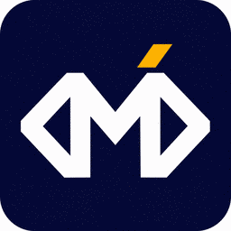

# Milán



> La única limitación es tu imaginación.

Milán es un lenguaje de programación gratuito y abierto bajo licencia MIT. Puedes mezclar español e inglés en el mismo programa. Esta rama contiene la candidata **1.1.0-rc.2**.

## Primer programa

Guarda este código como `saludar.milan`.

```milan
nombre = "Mundo"

funcion saludar(persona) {
    mostrar("Hola", persona)
}

saludar(nombre)
```

Instala Python 3.10 o posterior y descarga el repositorio. Desde su carpeta, ejecuta `python3 milan.py examples/saludar.milan` en Linux o macOS, o `py -3 milan.py examples/saludar.milan` en Windows. Verás `Hola Mundo`. El intérprete usa la biblioteca estándar de Python.

En VS Code, instala el VSIX de Milán, abre la carpeta de tu proyecto y pulsa **Ejecutar archivo actual** en un archivo `.milan`. La extensión incluye el intérprete y detecta Python.

- [Instalación y ejecución](docs/ejecutar.md)
- [Referencia bilingüe](docs/lenguaje.md)
- [Ejemplos](examples/)
- [Extensión de VS Code](vscode-milan/README.md)
- [Pruebas](tests/README.md)
- [Cambios y trabajo pendiente](CHANGELOG.md)

## Programa de ejemplo

Prueba [la lista de tareas persistente](examples/tareas.milan). Puedes añadir, completar y quitar tareas. [Guía para instalar el comando y ejecutar el ejemplo](docs/ejecutar.md).

## Principios

- **Un núcleo abierto:** el lenguaje y sus herramientas fundamentales deben poder usarse sin registro, pagos, editor obligatorio ni IA.
- **Aprender sin barreras innecesarias:** documentación clara, ejemplos progresivos, errores comprensibles y diseño inclusivo, también para personas con TDAH o dificultades de aprendizaje. No se presupone una única forma de aprender.
- **Sencillo al empezar, potente al crecer:** tipos inferidos por defecto y anotaciones opcionales; estilos de programación avanzados disponibles progresivamente.
- **Español e inglés:** palabras clave equivalentes, mezcla en un mismo archivo y futura herramienta de traducción.
- **Ecosistema interoperable:** bibliotecas propias y puentes con otros lenguajes, comenzando por Python.
- **Seguridad y transparencia:** permisos explícitos para operaciones sensibles, aislamiento cuando sea posible y cambios propuestos por IA sujetos a aprobación.

## Visión del lenguaje

La candidata ya permite mezclar español e inglés con bloques entre llaves. La sintaxis por indentación y las herramientas de traducción se contemplan en la hoja de ruta.

### Tipos y paradigmas

- Inferencia de tipos por defecto y anotaciones explícitas opcionales.
- Funciones, objetos, programación funcional y asincronía, enseñados de manera progresiva.
- Memoria automática por defecto, con mecanismos avanzados de control cuando estén bien definidos.
- Concurrencia accesible para principiantes y opciones de bajo nivel para profesionales.

### Ejecución y rendimiento

El intérprete actual está escrito en Python. La hoja de ruta contempla un núcleo propio en **Rust**. Se estudiarán tecnologías como **LLVM** para compilación nativa y **WebAssembly** para entornos compatibles, conservando un modo interpretado. El objetivo es ofrecer un modo sencillo y otro optimizado; no se prometen velocidades concretas.

### Bibliotecas y plataformas

Milán aspira a servir para web, aplicaciones, videojuegos, IA, servidores, automatización y sistemas mediante bibliotecas y herramientas específicas. Se priorizarán puentes con Python y, más adelante, JavaScript y bibliotecas nativas. Se buscará compatibilidad progresiva con Linux, Windows, macOS, Android, iOS y web, respetando las restricciones de cada plataforma.

## Milán Studio y otros editores (planificado)

Milán **no dependerá de un editor concreto**. La visión incluye:

- Milán Studio, editor propio con perfiles de accesibilidad, colores y tipografías personalizables, navegación por teclado y modo sin distracciones.
- Ampliación del soporte a VSCodium, Neovim y otros editores, según las contribuciones de la comunidad.
- Errores en modo principiante (explicaciones y soluciones) y profesional (detalles técnicos).
- Depuración y aprendizaje interactivos con tutoriales, ejercicios y ejemplos visuales.
- Gestor de paquetes por comandos y catálogo visual.

## Inteligencia artificial opcional (planificada)

Se desea integrar ayuda para comprender, generar y depurar código, y APIs sencillas para crear aplicaciones con IA. Se estudiarán modelos locales y servicios externos. Un agente podrá **proponer** archivos, cambios y pruebas, pero deberá solicitar aprobación antes de modificar el proyecto. Las funciones básicas del lenguaje deberán funcionar sin IA y, en la medida de lo posible, sin conexión.

## Hoja de ruta

Consulta [ROADMAP.md](ROADMAP.md). Las versiones y etapas son propuestas, no fechas ni funciones ya publicadas.

## Comunidad y contribuciones

Milán está pensado para que cualquier persona pueda **usar, estudiar, modificar y mejorar su núcleo abierto**. Son bienvenidas contribuciones de código, pruebas, documentación, accesibilidad, traducciones y ejemplos. Consulta [CONTRIBUTING.md](CONTRIBUTING.md). Las decisiones técnicas deben priorizar compatibilidad, claridad, seguridad y mantenimiento.

## Licencia

El proyecto utiliza la [licencia MIT](LICENSE). La licencia permite reutilización y modificación bajo sus condiciones. Los componentes de terceros conservan sus propias licencias.

---

**Milán: un lenguaje, muchas posibilidades. La única limitación es tu imaginación.**
